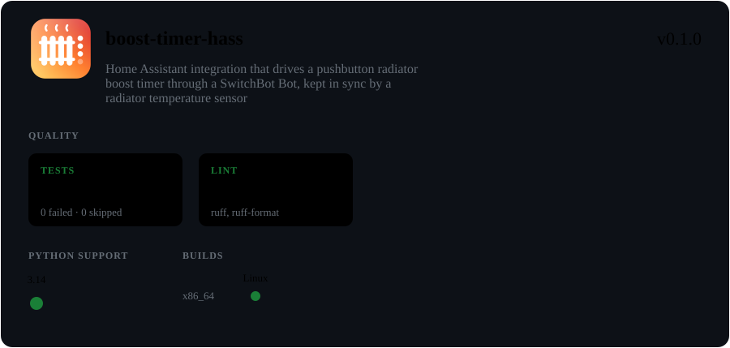

<!-- ghtools:sync status START — generated from the status branch, do not edit here -->



<!-- ghtools:sync status END -->

A Home Assistant integration that drives a dumb pushbutton boost timer (off / 1h / 2h / 3h / 4h,
one button, four LEDs) through a SwitchBot Bot, and keeps a model of what the timer is doing.

Quick presses (under ~5 s apart) cycle off → 1h → 2h → 3h → 4h → off; a press after a gap turns a
running timer off. The integration plans presses from that model and exposes:

- `switch.<name>_heating`: keep the radiator on (re-arming at each expiry) or turn it off
- `select.<name>_setting`: what the LEDs should show; choosing a value presses to it
- `sensor.<name>_expires_at`, `sensor.<name>_heating_until`, `binary_sensor.<name>_heating`,
  `binary_sensor.<name>_uncertain`
- actions `boost_timer.heat_for` (`duration` or `until`) and `boost_timer.sync` (correct the model
  without pressing)

## Install

Through HACS, as a custom repository: HACS → ⋮ → Custom repositories, add
`https://github.com/will-roscoe/boost-timer-hass` with type **Integration**, then download
**Boost Timer** and restart Home Assistant. Or copy `custom_components/boost_timer` from a release
into the Home Assistant `config/custom_components` directory and restart.

Then add **Boost Timer** under Settings → Devices & services, and pick the SwitchBot Bot that
presses the timer's button. Timings, the radiator sensor and the room sensors are in its options.

## Radiator sensor sync

The timer sometimes ignores a press, and a hand press is invisible to Home Assistant, so the model
can drift. With a temperature sensor stuck on the radiator and one or more room sensors chosen in the
integration's options, it corrects itself:

- It works out when the radiator started and stopped heating by comparing it with the room. Off,
  a radiator cools toward the room along a fixed physical curve; the curve's constants are learned
  from this radiator. There are no temperature thresholds, so it keeps working in summer, with the
  window open, or with the radiator turned down. Expect it to notice a switch 15-30 minutes late.
- If the radiator stopped before the model expected, the run was a whole number of hours shorter:
  the model is corrected (and re-armed if heating is still wanted). Heating seen while the model
  was off is taken as a hand press, assumed 1 hour and extended while it keeps heating.
- Corrections never press by themselves, and `switch.<name>_heating` keeps showing what was asked
  for. `binary_sensor.<name>_verified_heating` shows what the sensor says; graph it beside
  `binary_sensor.<name>_heating` to see whether they agree. `sensor.<name>_sync_corrections` counts
  today's corrections, and each one fires a `boost_timer_corrected` event.
- With no usable reading for an hour it stops checking (behaving as without a sensor), and after a
  day it raises a notification. After 6 corrections in a day it stops until midnight and says so.
  The "Correct the timer from the radiator sensor" option turns corrections off and leaves the
  sensor running.

### Room temperature

This integration doesn't hold a room temperature. Use Home Assistant's built-in
[generic thermostat](https://www.home-assistant.io/integrations/generic_thermostat/) with
`switch.<name>_heating` as its heater and a room sensor (not the radiator sensor) as its temperature,
with `min_cycle_duration` of at least 10 minutes. Leave its `keep_alive` unset: it would repeat
"turn off" and press against a hand press the sensor has adopted.

## Development

Needs Python 3.14 (Home Assistant 2026.10).

```bash
python3.14 -m venv .venv
.venv/bin/pip install -r requirements_test.txt
.venv/bin/pytest
```
